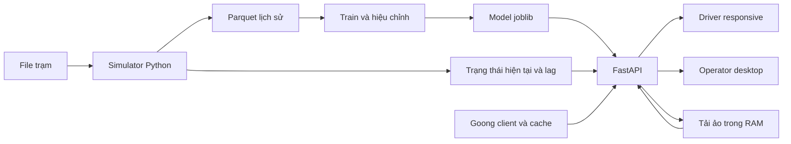

# Kiến trúc và lựa chọn công nghệ

## Stack đã chốt

| Lớp | Lựa chọn | Ghi chú |
| --- | --- | --- |
| Python | 3.11+ | Chọn cùng một minor version cho A/B/C; dependencies sẽ khóa khi khởi tạo code |
| Simulator | NumPy, pandas | Bước 5 phút; SimPy chỉ bổ sung nếu thực sự cần |
| ML | LightGBM, scikit-learn, joblib | Isotonic hoặc Platt trên calibration split riêng; SHAP P1 |
| API | FastAPI, Pydantic | Contracts ở `app/backend/contracts`; OpenAPI sinh tự động làm HTTP contract cho frontend |
| HTTP | Client Goong riêng | Cache ra file, timeout, lỗi/fallback rõ; kiểm tra chính sách cache/credit với mentor |
| Dữ liệu | JSON/CSV, Parquet, YAML | Cần pyarrow cho Parquet, PyYAML cho scenarios; không database server |
| Web | React + Vite + Goong Maps JS | D xác nhận SDK/tên gói/cách tích hợp theo docs chính thức khi cài |
| Demo | Chạy laptop | Docker Compose tùy chọn sau P0; video dự phòng |

Bảng này là quyết định thiết kế, chưa có lockfile/dependencies hoặc SDK đã cài ở commit sơ khai.

Backend dùng modular monolith trong `app/backend`: các module domain chỉ giao tiếp qua contracts/ports, infrastructure cung cấp adapter và `api` là composition root. Frontend nằm ở `app/frontend` và chỉ dùng OpenAPI đã commit. Xem design mới trong `docs/superpowers/specs`.

## Luồng xử lý

## Runtime

- API chỉ nạp trạm, model và cửa sổ trạng thái cần cho lag 60 phút; không bắt buộc nạp toàn bộ 180 ngày.
- Một worker cho demo, dict tải ảo trong RAM. Lock quanh cập nhật và reset để tránh hai request cùng đọc giá trị cũ. Khởi động lại sẽ mất tải ảo.
- `/simulate` và `/whatif` có trạng thái riêng theo lượt chạy, không dùng dict của Driver; mỗi strategy khởi tạo lại cùng fixtures.
- Goong route cache ở `app/backend/infrastructure/cache` có khóa theo tọa độ, tham số tuyến và thời điểm/TTL phù hợp, ghi thời điểm thu thập. Cache không bảo đảm ETA hiện thời.
- Frontend dùng map key riêng (public khi hiển thị trên trình duyệt); REST key ở backend. Thiết lập hạn chế key theo hỗ trợ của nhà cung cấp khi triển khai.
- Chỉ mock API hoặc model chưa có không được hiển thị là dự báo thật. Backend báo `MODEL_NOT_READY` hoặc mock mode rõ ràng.

## Demo khi mạng gặp vấn đề

Local API/model/simulator có thể chạy offline; bản đồ, tiles và route trực tuyến vẫn có thể cần mạng. Cache tuyến có sẵn cho demo cố định, có danh sách trạm/kế hoạch khi map lỗi, quay video dự phòng. Không cam kết Goong hoạt động offline hoàn toàn.

## Môi trường

`.env.example` chỉ là mẫu, chưa có code đọc biến. Sau khi thêm code, cập nhật lệnh cài/chạy đã kiểm tra vào tài liệu module. Không đưa key, lịch sử sinh lớn, model binary hoặc dữ liệu đối tác vào Git ngoài phạm vi được phép chia sẻ.
