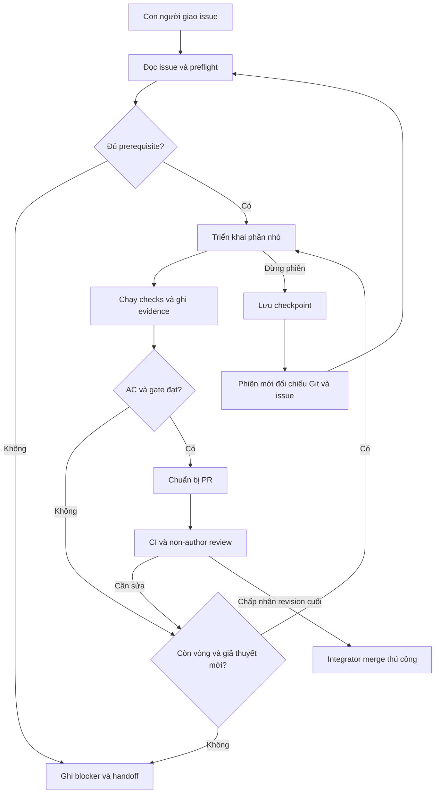

# Quy trình Issue → PR

Đây là quy trình chuẩn cho Codex/Claude và manual fallback. Canonical stage
skills/roles trong `.agents/` chỉ định tuyến tới quy trình và policy; xem
[Run one issue](RUN_AN_ISSUE.md) cho walkthrough. `project-init` onboarding,
`task-start`/`task-verify`/`task-ship` là stage helpers, `vev-issue` là entry point
explicit. Start/ship cần yêu cầu của người dùng cho issue đã giao cụ thể; không
auto-pick/claim/branch creation hoặc mở bulk workflow.

## 1. Nhận việc và chốt phạm vi

Con người giao một assignee, reviewer dự kiến và lane. Issue phải nêu goal/current/expected behavior, allowed scope và ngoài scope, AC ổn định cùng cách kiểm chứng, dependency và điều kiện sẵn sàng, contract impact, data origin, môi trường/giới hạn và rollback. Không dùng plan checkbox thay GitHub backlog.

Issue form có một khối JSON máy đọc với đúng một task spec chứa `lane`. Mẫu tối thiểu (các giá trị minh họa cần thay):

```json
{
  "lane": "web-map",
  "scope": ["app/frontend/src/services/**"],
  "acceptance": [
    {"id": "AC-01", "description": "Envelope hợp lệ được đọc", "verification": ["frontend-test", "build"]}
  ],
  "dependencies": [],
  "reviewer": "@verified-non-author",
  "contract_impact": "none",
  "data_origin": "committed mock fixtures",
  "rollback": "revert PR"
}
```

`dependencies` rỗng nghĩa là đã xác nhận không có prerequisite; nếu có, dùng `{"url": "https://github.com/thangak18/V-EV-Flow/pull/123", "ready": true}`. Script đối chiếu trạng thái GitHub; `ready` trong body không thay bằng chứng merge/closure. Các lane hợp lệ và phạm vi nằm trong [policy](policy.json); scope issue chỉ thu hẹp quyền đó. `verification` là danh sách check IDs của runner, không phải câu lệnh tự do. Không nhúng shell command để runner thực thi.

Chạy `doctor`, đọc AGENTS/SPEC/contracts/plan cần cho issue, rồi `start --issue N` hoặc URL. Snapshot giữ URL/title/body/assignees/updatedAt, thời điểm fetch và body hash. Resume phải lấy issue mới; issue đổi, assignee/dependency/base không đủ hoặc Foundation chưa accepted là `BLOCKED`. Offline replay dùng `--snapshot FILE` cho test hoặc phần không phụ thuộc mạng; provenance offline không đủ cho readiness cuối.

Foundation origin là SHA immutable ở policy, integration base là SHA `main` đã tích hợp prerequisites hiện tại. Một issue/một writer mỗi lane; integrator điều phối giữa máy, local active-task không khóa toàn nhóm. Chỉ tạo bốn owner branches từ Foundation đã accepted, rồi merge tooling/dependency prerequisites từ `main`. Bootstrap/tooling/contract dùng ngoại lệ nhánh ở policy. Không reset/stash tự động thay đổi người khác.

Plan ngắn ghi files được sửa, mỗi AC → check/assertion/artifact, data/contract
impact, câu hỏi còn mở và bước tiếp theo trong checkpoint. Không tự post plan
comment lên GitHub nếu chưa có yêu cầu. Hook canary là optional diagnostic cho
một PreToolUse observation; thiếu/trust hook không đủ không chặn core workflow.

## 2. Triển khai và kiểm chứng

Dependency issue chỉ được chấp nhận khi GitHub trả `state=closed` và `state_reason=completed`; đóng vì cancelled/not-planned không đủ. Dependency PR phải merged. Cờ `ready:false` trong task spec luôn chặn bắt đầu; `ready:true` vẫn cần bằng chứng GitHub.



`scope --issue N --base SHA` kiểm tra cả committed/staged/unstaged/untracked paths; rename xét cả nguồn và đích. Protected denylist ưu tiên allowlist; policy đọc từ base đáng tin cậy, feature branch không tự cấp quyền. Owner chỉ được sửa handoff đúng số issue mình.

Sửa một lát cắt có test hành vi, mapping mỗi AC tới lệnh/artifact. `run --issue N --check NAME --ac AC-01` chỉ gọi gate được định nghĩa; `--ac` lặp được. Runner hỗ trợ focused IDs `backend-test`, `frontend-test`, `e2e-test` với `--path` là test file trong repo. Ví dụ: `run --issue N --check frontend-test --path app/frontend/src/services/api.test.ts --ac AC-01`. Chạy lệnh tập trung trực tiếp để debug được, nhưng evidence readiness cần ghi qua runner.

| Thay đổi | Kiểm chứng tập trung |
| --- | --- |
| Backend/module | Unit success/failure, lint/type, architecture, port conformance |
| API/contract | Examples, generation, consumer tests, error shape, CI oasdiff against main |
| Frontend | Service/component tests, loading/error/empty, build, E2E/screenshot khi UI đổi |
| Simulator/ML | Seed, conservation/temporal splits/leakage, fixture provenance |
| Harness/tooling | Scope/stale evidence/hook fixtures, self-check, fresh checkout |

Makefile là nguồn lệnh. `setup` cài frozen locks và Chromium; `ci` gồm quality/tests/build/contracts/smoke/security/harness checks. Oasdiff là gate CI bổ sung. Smoke phải tạo server của checkout này; port bận là `BLOCKED`, không kill hoặc tái sử dụng tiến trình khác.

`verify --issue N` chọn fixed scoped Make gates từ touched paths và consumer
impact, ghi evidence cùng runner. Backend/frontend có lint/test-suite gates
riêng để feedback tập trung; build/contracts/smoke/security/harness gates dùng
định nghĩa hiện có. Output và implementation của runner xác định danh sách
checks thực, không lấy shell commands từ issue. Mỗi AC vẫn phải có assertions
và artifacts thực; chỉ liệt kê AC hoặc suite exit 0 không chứng minh assertion.
Scoped PASS không thay full gate: sau commit sạch, `verify --issue N --full`
ghi fresh `make ci` trên revision đó.

Full verify cũng ghi lại các gate mà AC khai báo. Focused check không tự chọn
test file: cung cấp `run --check ... --path ... --ac ...`. Runner chỉ reuse
focused evidence đã thực thi khi code/issue identity và log hash khớp; thiếu
bằng chứng hợp lệ vẫn là `NOT RUN` với exit nonzero, không phải PASS từ registry.

Tối đa ba vòng sửa cho cùng một lỗi, mỗi vòng ghi giả thuyết mới và kiểm tra lại. Sau 60 phút làm việc chủ động hoặc trước đổi phiên/công cụ, lưu checkpoint. Thiếu dữ liệu/quyền, scope tăng, quota hết hoặc hết vòng: ghi blocker, tiếp tục phần độc lập khi còn. Mặc định tối đa một agent phụ đồng thời khi nhiệm vụ độc lập có lợi ích rõ; không tự dùng API trả phí thay subscription hết quota. Chỉ đưa đoạn log liên quan vào context.

Read-only `code-reviewer`, `qa-backend`, `qa-e2e`, `qa-dispatcher` là optional
roles. QA chỉ chạy khi được yêu cầu hoặc plan cần; một agent phụ đồng thời theo
mặc định. Tester dùng existing tests, không sửa product/tests để đạt PASS;
dispatcher đối chiếu evidence, duplicates và plan coverage. Caller giữ reports
với actual HEAD/base, AC/assertions, commands/exits và artifact links. Named role
không có ở runtime thì dùng cùng canonical prompt với read-only subagent/human
reviewer; checks chưa chạy ghi `NOT RUN`. Agent verdict không là human approval.

## 3. Evidence và bàn giao

| Result | Nghĩa |
| --- | --- |
| `PASS` | Đã chạy, exit 0 và đạt assertions/tiêu chí |
| `FAIL` | Đã chạy và không đạt |
| `BLOCKED` | Thiếu prerequisite/môi trường/quyền để kiểm chứng |
| `NOT RUN` | Chưa chạy; không tương đương PASS |

Evidence v1 theo [schema](schemas/evidence.schema.json): issue/AC, tool/surface/version, argv/cwd, thời điểm/exit, head/base, dirty fingerprint, môi trường, path/hash logs/artifacts. Lệnh runner phát hiện prerequisite thiếu hoặc port conflicts phải ghi BLOCKED. Exit CLI gate: 0 đạt, 1 không đạt, 2 bị prerequisite chặn; giữ exit thực của command trong manifest.

HEAD/base/diff/dependency/issue đổi làm evidence không đủ cho revision mới; giữ evidence cũ như lịch sử. Log mất hoặc hash đổi phải chạy lại. `ready --issue N` kiểm tra clean state, scope, handoff, AC mapping và evidence còn hiệu lực; không approve/merge hoặc chứng nhận review GitHub.

Dùng `handoff --issue N` để tạo khung lần đầu (không overwrite file đã có), sau đó cập nhật checkpoint thủ công và hoàn thiện phần quyết định/AC/remaining/blockers/next step/retries trong [template](templates/handoff.md). File track `docs/harness/handoffs/N.md` giữ checkpoint ngắn; JSON fenced đầu tiên là metadata máy đọc. `.harness/issues/N/sessions/...` chỉ chứa snapshot/log/evidence local ignored, không là bản bàn giao duy nhất.

Commit code và checkpoint trước gate cuối. `head` trong handoff là commit tại thời điểm ghi checkpoint, không cần SHA tự tham chiếu tới commit chứa nó. Handoff được phép ghi final gate chờ; sau commit sạch chạy gate cuối, đưa kết quả đúng SHA vào PR/CI artifacts. Đừng sửa/commit handoff chỉ để chép PASS mới và khiến chính evidence đó stale.

Giữa người/máy: pushed checkpoint/draft PR hoặc patch được chuyển rõ ràng. Mark partial checkpoint `implemented`/blocked nếu chưa verified. Phiên mới bắt buộc đối chiếu issue hash, branch, HEAD, diff, base/dependencies và handoff trước sửa; native resume chỉ bổ sung lịch sử.

## 4. PR, review và merge

Metadata handoff có thêm **blocked** khi cần đầu vào. Bốn mức hoàn thành: **implemented** có code; **verified** AC/gates đạt trên revision xác định; **review-ready** thêm scope/clean state/PR evidence/CI; **merged** chỉ khi GitHub xác nhận và integrator hoàn tất issue. Không dùng Stop hook hay file tồn tại để nâng trạng thái.

PR ghi scope/owner/contract impact, AC → evidence, head/base, exact commands/results, CI links, screenshot/trace khi cần, source/limitations/rollback và handoff. Runner không tự claim issue, tạo branch, push, gửi thông báo, approve, đóng issue hoặc merge; những bước đó do người vận hành thực hiện theo quyền phiên.

Khi người dùng yêu cầu ship/chuẩn bị PR, stage helper có thể commit/push policy
branch và mở/update draft PR trong quyền đó, sau scope/checkpoint/full gate và
review findings. Không suy ra quyền gửi GitHub comments, approve, merge hoặc
đóng issue từ việc skill được discover. Agent review không nâng completion
state hoặc thay non-author reviewer thật.

Integrator kiểm tra latest head/base, fresh local `make ci` trên commit sạch, toàn bộ CI required, non-author approval trên revision cuối, conversations resolved và evidence scope/AC. Commit mới/base đổi kích hoạt chạy lại. Squash merge thủ công trong pilot; không force-push/admin bypass. Nếu chưa có branch protection cưỡng chế, ghi checklist review thật theo [runbook](../runbooks/branch-protection.md).

Logs/traces artifacts giữ 14 ngày; PR giữ summary/SHA/results/limitations lâu dài. Khi artifact hết hạn mà cần tái kiểm toán, chạy lại trên commit liên quan và ghi thời điểm mới. Không coi summary là log mới.
